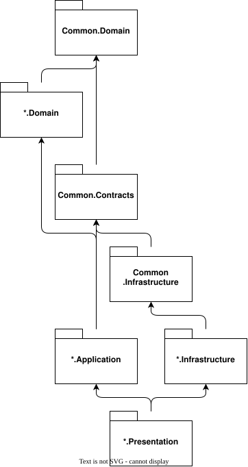
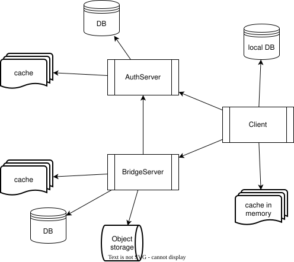
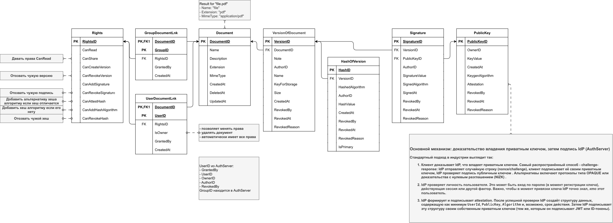
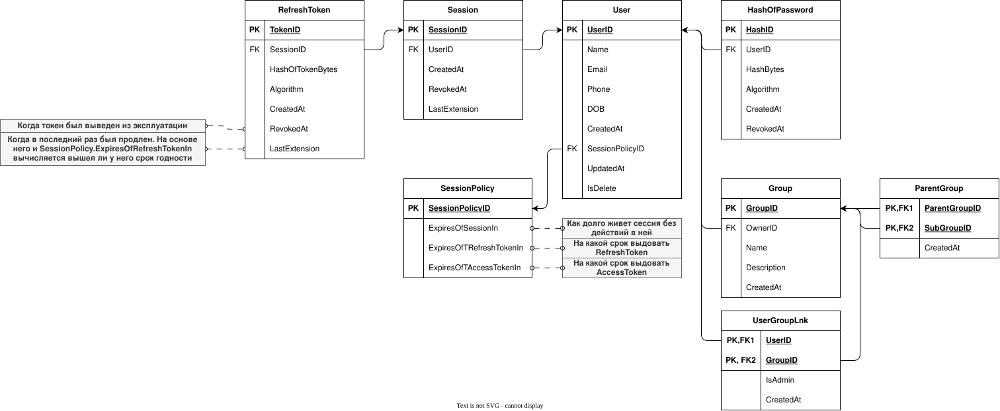
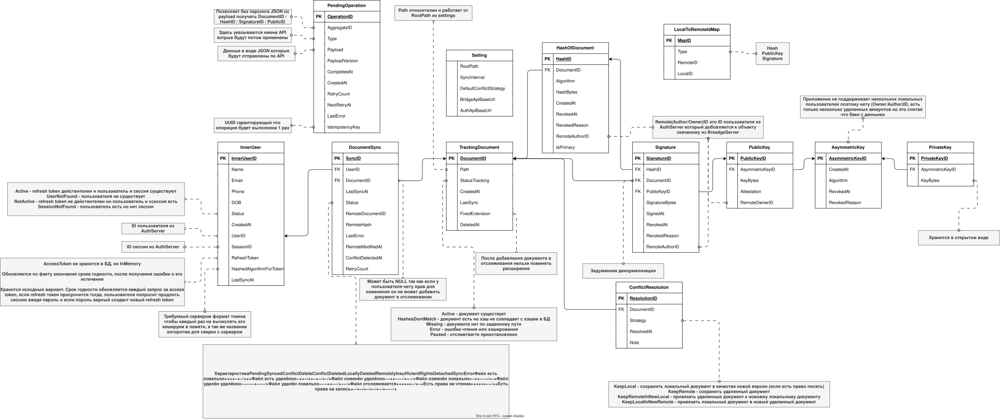

# SecureEDM

## Технические решения

**AuthServer/BridgeServer/Client:**

- Язык программирования: C# 
- Архитектура: Чистая архитектура

**AuthServer/BridgeServer:**

- СУБД: PostgreSQL
- Cache: Redis
- Server framework: ASP.NET Core
- DB framework: Dapper

**Client:**

- СУБД: SQLite
- Cache: InMemory
- UI framework: Avalonia
- DB framework: EF Core

## Архитектурные принципы

### Границы bounded contexts

- **AuthServer** — единственный источник истины о **пользователях**, **группах**, **сессиях** и **публичных ключах пользователей** (в виде attestation). Все `UserID`/`GroupID` в других системах — opaque-идентификаторы из AuthServer, без FK.

- **BridgeServer** — единственный источник истины о удаленных **документах**, **версиях**, **хешах**, **подписях** и **правах доступа на документы**. Не хранит пользователей и группы, только ссылается на них.

- **Client** — единственное место, где живут **приватные ключи** и происходит **подписывание**. Приватные ключи никогда не покидают клиент.

- **Common** — только то, что реально общее для всех трёх систем: примитивы домена, контракты обмена, криптопримитивы (верификация подписи, хеширование), загрузчик плагинов. **В `Common.Domain` не попадают сущности с бизнес-смыслом конкретной системы** (`User`, `Document`, `Session` — нет).

### Направление зависимостей



### Правило слоев

| Слой | Что можно | Что нельзя |
|---|---|---|
| `*.Domain` | сущности, value-objects, доменные исключения, доменные интерфейсы (без зависимостей) | ссылки на EF/Dapper/HTTP, DTO обмена |
| `*.Application` | use-cases, оркестрация контрактами и моделями, **никаких интерфейсов инфраструктуры** (они в `Common.Contracts` или `*.Contracts`) | прямые ссылки на `*.Infrastructure` |
| `*.Infrastructure` | реализации контрактов, EF/Dapper, HTTP-клиенты, плагины | бизнес-логика |
| `*.Presentation` | контроллеры (сервер) или ViewModel'и (клиент) | бизнес-логика, прямые обращения к БД |
| `Common.Contracts` | интерфейсы + DTO обмена, версия API | сущности домена |

---

## Взаимодействие систем

### System desing



### Протоколы и роли

```
Client ──HTTPS──> AuthServer    (регистрация, логин, refresh, аттестация ключа)
Client ──HTTPS──> BridgeServer  (документы, версии, хеши, подписи, права)
BridgeServer ──HTTPS──> AuthServer (JWKS, проверка attestation, опционально проверка прав)
```

- **Клиент -> AuthServer** — только для аутентификации и регистрации публичных ключей. После получения токенов клиент работает с BridgeServer напрямую.

- **Клиент -> BridgeServer** — с access-токеном в `Authorization: Bearer`. BridgeServer проверяет токен локально (JWKS), не ходя в AuthServer на каждый запрос.
- **BridgeServer -> AuthServer** — только для:

  - получения JWKS (кешируется, обновляется по `kid`);
  - проверки attestation публичного ключа (публичный ключ AuthServer известен из JWKS).

### Токены

- **AccessToken** — JWT, короткоживущий (минуты), подписан ключом AuthServer. Claims: `sub` (UserID), `groups` (список GroupID), `iat`, `exp`, `kid`. BridgeServer проверяет подпись через JWKS и **не ходит в AuthServer**.

- **RefreshToken** — opaque-строка, долгоживущая (дни), хранится в БД AuthServer **как хеш** (`HashOfTokenBytes` + `Algorithm`). При refresh — ротация: старый токен получает `RevokedAt`, выдаётся новый.

- **Сессии** — sliding с hard cap. `Session.LastExtension` обновляется при refresh;

### Аттестация публичного ключа

Поток:

1. Клиент генерирует пару ключей локально. Приватный ключ **никогда** не покидает клиент.
2. Клиент аутентифицируется в AuthServer (логин/refresh).
3. Клиент проходит **challenge-response**: AuthServer отправляет nonce, клиент подписывает его приватным ключом, AuthServer проверяет подпись публичным.
4. AuthServer формирует attestation: `(UserID, PublicKeyID, PublicKey, Algorithm, IssuedAt)` и подписывает своим приватным ключом.
5. Клиент (или AuthServer) регистрирует ключ в BridgeServer с attestation.
6. BridgeServer проверяет attestation подписью AuthServer (публичный ключ из JWKS) и сохраняет `PublicKey`.

При проверке подписи документа BridgeServer проверяет цепочку:

```
Signature.SignatureBytes  ─верификация─>  PublicKey.Key
PublicKey.Attestation     ─верификация─>  ключ AuthServer (из JWKS)
PublicKey.RevokedAt IS NULL
VersionOfDocument.RevokedAt IS NULL
HashOfVersion.RevokedAt IS NULL
Signature.RevokedAt IS NULL
```

Без хотя бы одной проверки цепочка доверия рвётся.

---

## Модель прав доступа (BridgeServer)

### ER database

#### BridgeServer



#### AuthServer



#### Client



### Субъекты прав

- **Пользователь** (`UserDocumentLnk`) — прямой грант. 

- **Группа** (`GroupDocumentLnk`) — грант группе; пользователь получает права, если он в группе (членство — в claims access-токена, `groups`).

- **Владелец** (`UserDocumentLnk.IsOwner = true`) — особый случай, автоматически имеет все права и может передавать владение.

Группа **не может** быть владельцем документа — владелец только пользователь.

### Действия (`Rights`)

- `CanRead` — читать документ и его версии.

- `CanShare` — выдавать права на чтение другим пользователям/группам.

- `CanCreateVersion` — создавать новую версию.

- `CanRevokeVersion` — отзывать **чужие** версии (свою версию автор может отозвать всегда).

- `CanAddSignature` — добавлять подпись к версии.

- `CanRevokeSignature` — отзывать **чужие** подписи (свою подпись автор может отозвать всегда).

- `CanAttestHash` — добавлять альтернативный хеш (другим алгоритмом) к существующей версии.

- `CanAddHashAlgorithm` — добавлять хеш с новым алгоритмом, которого ещё нет у версии.

- `CanRevokeHash` — отзывать **чужие** хеши (свой хеш автор может отозвать всегда).

### Каскад отзыва

Отзыв версии (`VersionOfDocument.RevokedAt`) делает недействительными **все** её хеши и подписи при проверке — даже если у них `RevokedAt IS NULL`. Это правило проверки, а не каскадная запись (для аудита каждый отзыв фиксируется отдельно). Если нужен каскад в БД — триггер, но семантика та же: «отозванная версия не может считаться подписанной».

### Проверка прав

- При запросе к BridgeServer: токен проверен (JWKS), `UserID` и `groups` извлечены из claims.

- Права проверяются в БД: `UserDocumentLnk` для `UserID` + `GroupDocumentLnk` для каждого `GroupID` из claims.

- Результат — объединение прав (union): если пользователь имеет право напрямую **или** через группу — право есть.

- Владелец (`IsOwner = true`) имеет все права неявно.
